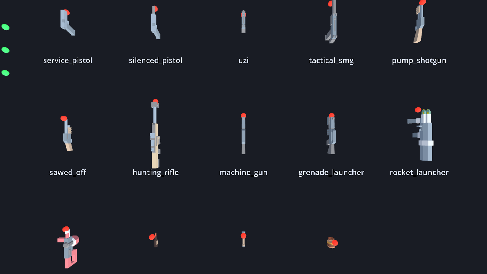

This is a weapons pack to demonstrate the capabilities of the [**Dot collection**](https://moddingcommunity.com/co/4-dot-assets) built on-top of [Godot 4](https://godotengine.org/) and [TMC's gaming platform](https://moddingcommunity.com/play). It is a second pack on top of [zee-dot-weapons](https://github.com/zees-games/zee-dot-weapons): fourteen more weapons with a real-world look (pistols, an Uzi, shotguns, a hunting rifle, a machine gun, launchers and a flamethrower) and the throwables a zombie game needs (a molotov, a pipe bomb and a bile jar). It was made for [game-zombie-zone](https://github.com/zees-games/game-zombie-zone), and any game on zee-dot-weapons can carry both packs at once.

**This pack and the assets under it are COMPLETELY OPEN SOURCE**. You are free to use, modify, and distribute them under the terms of the MIT license, and the art it ships is CC0, which asks for even less. The only thing not open source is the back-end web infrastructure. So if you opt into using your own authentication backend instead of integrating with TMC, you will need to build and integrate your own back-end infrastructure.

## From Maintainer & WARNING
This pack, along with every asset it is built on, was built initially with **Claude Code** and will continue to be maintained and extended using it. This is because I (`gamemann`) cannot build the entire TMC platform alone (I wish I could lol).

**Please treat this as partially tested.** It has its own headless test suite and that suite passes, but very little of this has been in front of real players yet. Expect rough edges, and please report anything you run into.

I intend on reviewing code, testing, and editing documentation regularly. If you're interested in helping out, please let me know!

## What is in it
The eleven real-world guns are our own kitbashes (parts of Quaternius's Ultimate Low Poly Guns and Kenney's Blaster Kit, CC0, rebuilt by `art-src/guns/`); the rest is Kenney's **Weapon Pack** (ammunition, pipe bomb), with the molotov and the bile jar from his **Food Kit**. All of it is CC0 and included, so there is nothing to download.



| Slot | Weapons |
| --- | --- |
| 2 · Sidearm | Service Pistol, Silenced Pistol, Uzi |
| 3 · Primary | Tactical SMG, Pump Shotgun, Sawed-Off, Hunting Rifle |
| 4 · Heavy | Machine Gun, Grenade Launcher, Rocket Launcher, Flamethrower |
| 5 · Thrown | Molotov, Pipe Bomb, Bile Jar |

The guns share zee-dot-weapons' ammunition, so a box of ammo fills both packs' guns. The flamethrower has its own fuel tank and no reload. The throwables are one each.

What a throwable does when it lands is up to the game, because dot-weapon spawns nothing itself. Each one says what it is with a tag (`molotov`, `pipe_bomb`, `bile`), and the flamethrower is tagged `incendiary`. In game-zombie-zone a molotov starts a fire, a pipe bomb beeps, draws the horde to it and goes off, and a bile jar brings every zombie nearby to where it broke.

**Workshop pack.** `provides.json` and `weapons/*.tres` publish the fourteen weapons as a schema-1 Workshop weapon pack (kind `weapon`, like zee-dot-weapons), so subscribing to the pack makes them appear in a `DotWeaponCatalogue` that follows the content index. They are generated from the code table by `tools/export-defs.sh`.

## Using it
Link `addons/zed_weapons` next to `addons/zee_weapons` and call `install()` once, before you build your first weapon rig:

```gdscript
ZedWeaponPack.install()
```

That adds the fourteen weapons to zee-dot-weapons' catalogue, their models to its art table and their reports to its sounds, so every rig, view model and world model in your game carries both packs with nothing else changed. `ZedWeaponPack.uninstall()` takes them out again.

The models are under `assets/`. A game that vendors them (because it is delivered as a pack) copies `assets/weapon-pack` and `assets/food-kit` next to zee's art, and zee's `ZeeModelCache.set_asset_root` finds them the same way.

## Requirements
Godot **4.7**, [zee-dot-weapons](https://github.com/zees-games/zee-dot-weapons) (with its `add_source` support), and what it needs: [dot-core](https://github.com/modcommunity/dot-core), [dot-combat](https://github.com/modcommunity/dot-combat) and [dot-weapon](https://github.com/modcommunity/dot-weapon).

## Running it
| Command | What it does |
| --- | --- |
| `godot --path .` | A firing range holding every weapon in both packs |
| `godot --headless --path . res://examples/zed_selftest.tscn` | The test suite |
| `tools/screenshot.sh --rack` | Every weapon on a rack, with a red pip on each muzzle |
| `tools/screenshot.sh <id>` | One weapon in first person |

The range and the rack draw zee's arms, so link `assets/arms`, `assets/blaster-kit` and `assets/melee` from a zee-dot-weapons checkout (dot-bootstrap does).

## Credits
The eleven real-world guns (`assets/kitbash/`) are kitbashed by the Blender scripts in `art-src/guns/` (one recipe per gun in `zed_guns.py`, `blender -b --python art-src/guns/build.py` rebuilds them): parts of [Quaternius](https://quaternius.com)'s [Ultimate Low Poly Guns Pack](https://opengameart.org/content/low-poly-guns-pack) (CC0) and of Kenney's [Blaster Kit](https://kenney.nl/assets/blaster-kit) (CC0) are cut, reshaped, joined with barrels, muzzle devices, sights, rails, magazines and tubes modelled in the script, recoloured and bevelled, so no gun is any one source model. The pipe bomb and the magazines and rounds a reload carries are Kenney's Weapon Pack, and the wine bottle and the honey jar are his Food Kit ([kenney.nl](https://kenney.nl), CC0). Each kit's licence is next to its files.

## License
MIT. See [LICENSE](LICENSE). The Kenney art is CC0, which is public domain.
