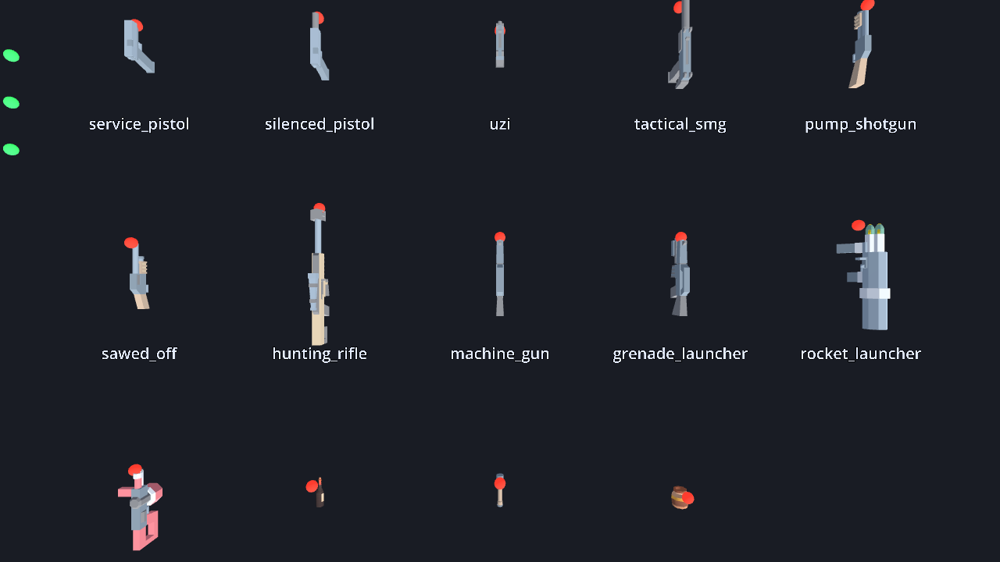

Sixteen more weapons for [zee-dot-weapons](https://github.com/zees-games/zee-dot-weapons), with a real-world look: pistols, an Uzi, an assault carbine, an AK rifle, shotguns, a hunting rifle, a machine gun, launchers and a flamethrower, plus the throwables a zombie game needs (a molotov, a pipe bomb and a bile jar). Made for [game-zombie-zone](https://github.com/zees-games/game-zombie-zone). Any game that uses zee-dot-weapons can carry both packs at once. It is part of the [Dot collection](https://moddingcommunity.com/co/4-dot-assets) for Godot 4.

The pack has its own test suite, but little of it has been in front of real players. Please report anything you run into.



| Slot | Weapons |
| --- | --- |
| 2 Sidearm | Service Pistol, Silenced Pistol, Uzi |
| 3 Primary | Assault Carbine, Tactical SMG, Pump Shotgun, Sawed-Off, Hunting Rifle |
| 4 Heavy | Machine Gun, Grenade Launcher, Rocket Launcher, Flamethrower |
| 5 Thrown | Molotov, Pipe Bomb, Bile Jar |

The guns share zee-dot-weapons' ammunition, so a box of ammo fills both packs' guns. The flamethrower has its own fuel tank and no reload. Throwables are one each.

The assault carbine is a high-detail gun (`assets/hq/`, about 13k triangles). It has sockets for six attachments, listed by `ZedWeaponPack.attachments()`: red dot, 4x scope, suppressor, foregrip, laser sight and extended magazine.

What a throwable does when it lands is up to the game, because dot-weapon spawns nothing itself. Each one carries a tag (`molotov`, `pipe_bomb`, `bile`), and the flamethrower is tagged `incendiary`. In game-zombie-zone a molotov starts a fire, a pipe bomb beeps, draws the horde and goes off, and a bile jar pulls nearby zombies to where it broke.

## Using it

Link `addons/zed_weapons` next to `addons/zee_weapons` and call `install()` once, before you build your first weapon rig:

```gdscript
ZedWeaponPack.install()
```

That adds the sixteen weapons to zee-dot-weapons' catalogue, their models to its art table and their reports to its sounds. `ZedWeaponPack.uninstall()` takes them out again.

The models are under `assets/`. A game that vendors them (because it is delivered as a pack) copies `assets/weapon-pack` and `assets/food-kit` next to zee's art.

The pack is also published as a Workshop weapon pack: `provides.json` and `weapons/*.tres` (kind `weapon`), generated from the code table by `tools/export-defs.sh`. Subscribing to it adds the weapons to a `DotWeaponCatalogue` that follows the content index.

## Requirements

Godot 4.7, [zee-dot-weapons](https://github.com/zees-games/zee-dot-weapons) (with its `add_source` support), and what it needs: [dot-core](https://github.com/modcommunity/dot-core), [dot-combat](https://github.com/modcommunity/dot-combat) and [dot-weapon](https://github.com/modcommunity/dot-weapon). [dot-bootstrap](https://github.com/modcommunity/dot-bootstrap) fetches them.

## Running it

| Command | What it does |
| --- | --- |
| `godot --path .` | A firing range holding every weapon in both packs |
| `godot --headless --path . res://examples/zed_selftest.tscn` | The test suite |
| `tools/screenshot.sh --rack` | Every weapon on a rack, with a red pip on each muzzle |
| `tools/screenshot.sh <id>` | One weapon in first person |

The range and the rack draw zee's arms, so link `assets/arms`, `assets/blaster-kit` and `assets/melee` from a zee-dot-weapons checkout (dot-bootstrap does).

## Credits

The eleven real-world guns (`assets/kitbash/`) are rebuilt by `blender -b --python art-src/guns/build.py` (one recipe per gun in `zed_guns.py`). Parts are cut, reshaped and joined with modelled barrels, sights, rails and magazines, so no gun is any one source model. Each kit's licence is next to its files.

| Asset | Author / source | Licence |
| --- | --- | --- |
| Eleven real-world guns (parts) | [Quaternius](https://quaternius.com), [Ultimate Low Poly Guns Pack](https://opengameart.org/content/low-poly-guns-pack) | CC0 1.0 |
| Eleven real-world guns (parts) | [Kenney](https://kenney.nl/assets/blaster-kit), Blaster Kit | CC0 1.0 |
| Pipe bomb, magazines and rounds | [Kenney](https://kenney.nl), Weapon Pack | CC0 1.0 |
| Molotov (wine bottle), bile jar (honey jar) | [Kenney](https://kenney.nl), Food Kit | CC0 1.0 |
| High-detail carbine and attachments (`assets/hq/`) | TMC: modelled and textured procedurally by `art-src/hq/` | CC0 1.0 |
| Code | TMC | MIT, see [LICENSE](LICENSE) |
