Sixteen real-world weapons and zombie-game throwables for GameSpice games: pistols, an Uzi, assault rifles, shotguns, a hunting rifle, a machine gun, two launchers, a flamethrower, a molotov, a pipe bomb and a bile jar. It adds to zee-dot-weapons rather than replacing it, and every number below is a default read straight from the pack's data that a game or server can change without touching the pack.

### In GameSpice and Fatal Contact

- **GameSpice:** the pack is published to the Workshop as `gamemann/zed-dot-weapons`, beside `gamemann/zee-dot-weapons`, which it needs. A server lists both in its pack overlay, so players get them with the server and there is nothing to install. The weapons appear in the spawn menu under Sidearms, Primary, Heavy and Thrown.
- **Fatal Contact:** FC's own weapons are [fc-weapons](https://github.com/zees-games/fc-weapons). An FC server can add this pack and zee-dot-weapons to its overlay for extra weapons.
- **Your own Godot game:** link `addons/zed_weapons` beside `addons/zee_weapons` and call `ZedWeaponPack.install()`, as in [Using it](#using-it). Server owners retune any weapon in `cfg/addons/zed_weapons/weapon/<id>.yml`.

The weapons extend [zee-dot-weapons](https://github.com/zees-games/zee-dot-weapons) with a real-world look. Made for [game-zombie-zone](https://github.com/zees-games/game-zombie-zone). Any game that uses zee-dot-weapons can carry both packs at once. It is part of the [GameSpice collection](https://gamespice.net) for Godot 4.

The pack has its own test suite, but little of it has been in front of real players. Please report anything you run into.


| Slot | Weapons |
| --- | --- |
| 2 Sidearm | Service Pistol, Silenced Pistol, Uzi |
| 3 Primary | Assault Carbine, Tactical SMG, Pump Shotgun, Sawed-Off, Hunting Rifle |
| 4 Heavy | Machine Gun, Grenade Launcher, Rocket Launcher, Flamethrower |
| 5 Thrown | Molotov, Pipe Bomb, Bile Jar |

The guns share zee-dot-weapons' ammunition, so a box of ammo fills both packs' guns. The flamethrower has its own fuel tank and no reload. Throwables are one each.

The assault carbine is a high-detail gun (`assets/hq/`, about 13k triangles). It has sockets for six attachments, listed by `ZedWeaponPack.attachments()`: red dot, 4x scope, suppressor, foregrip, laser sight and extended magazine.

What a throwable does when it lands is up to the game, because dot-weapon spawns nothing itself. Each one carries a tag (`molotov`, `pipe_bomb`, `bile`), and the flamethrower is tagged `incendiary`. In game-zombie-zone a molotov starts a fire, a pipe bomb beeps, draws the horde and goes off, and a bile jar pulls nearby zombies to where it broke.

<!-- gen_readme:summary -->
| | Weapon | Class | Damage | Fire rate |
| --- | --- | --- | --- | --- |
| <a href="#service-pistol"></a> | [Service Pistol](#service-pistol) | Pistol | 28 | one shot every 0.16 s |
| <a href="#silenced-pistol">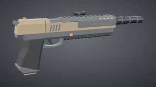</a> | [Silenced Pistol](#silenced-pistol) | Pistol | 24 | one shot every 0.16 s |
| <a href="#uzi">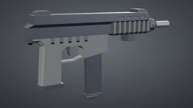</a> | [Uzi](#uzi) | SMG | 14 | 960 rpm |
| <a href="#assault-carbine">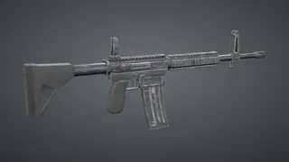</a> | [Assault Carbine](#assault-carbine) | Assault rifle | 26 | 768 rpm |
| <a href="#ak-rifle">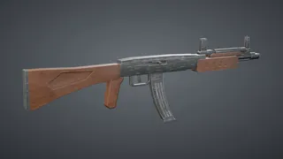</a> | [AK Rifle](#ak-rifle) | Assault rifle | 32 | 640 rpm |
| <a href="#tactical-smg">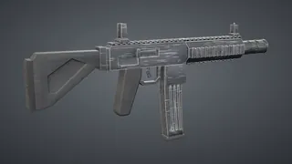</a> | [Tactical SMG](#tactical-smg) | SMG | 19 | 768 rpm |
| <a href="#pump-shotgun">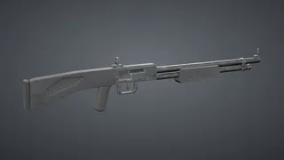</a> | [Pump Shotgun](#pump-shotgun) | Shotgun | 14 x 10 | one shot every 0.86 s |
| <a href="#sawed-off">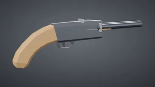</a> | [Sawed-Off](#sawed-off) | Shotgun | 12 x 14 | one shot every 0.25 s |
| <a href="#hunting-rifle">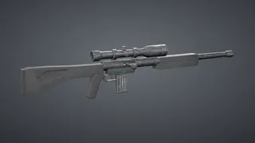</a> | [Hunting Rifle](#hunting-rifle) | Rifle | 90 | one shot every 1 s |
| <a href="#machine-gun">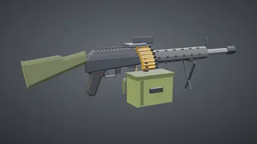</a> | [Machine Gun](#machine-gun) | Heavy | 22 | 768 rpm |
| <a href="#grenade-launcher"></a> | [Grenade Launcher](#grenade-launcher) | Launcher | 30 | one shot every 1 s |
| <a href="#rocket-launcher">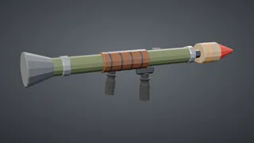</a> | [Rocket Launcher](#rocket-launcher) | Launcher | 60 | one shot every 1.5 s |
| <a href="#flamethrower"></a> | [Flamethrower](#flamethrower) | Heavy | 5 x 4 | 640 rpm |
| <a href="#molotov"></a> | [Molotov](#molotov) | Thrown | - | one throw every 1 s |
| <a href="#pipe-bomb"></a> | [Pipe Bomb](#pipe-bomb) | Thrown | 300 splash | one throw every 1 s |
| <a href="#bile-jar"></a> | [Bile Jar](#bile-jar) | Thrown | - | one throw every 1 s |

*Rates are the time between shots and ignore reloading; rpm is the cyclic rate of an automatic weapon.*
<!-- /gen_readme:summary -->

## Using it

Link `addons/zed_weapons` next to `addons/zee_weapons` and call `install()` once, before you build your first weapon rig:

```gdscript
ZedWeaponPack.install()
```

That adds the sixteen weapons to zee-dot-weapons' catalogue, their models to its art table and their reports to its sounds. `ZedWeaponPack.uninstall()` takes them out again.

The models are under `assets/`. A game that vendors them (because it is delivered as a pack) copies `assets/weapon-pack` and `assets/food-kit` next to zee's art.

The pack is also published as a Workshop weapon pack: `provides.json` and `weapons/*.tres` (kind `weapon`), generated from the code table by `tools/export-defs.sh`. Subscribing to it adds the weapons to a `DotWeaponCatalogue` that follows the content index.

## Requirements

Godot 4.7, [zee-dot-weapons](https://github.com/zees-games/zee-dot-weapons) (with its `add_source` support), and what it needs: [dot-core](https://github.com/gamespice-platform/core), [dot-combat](https://github.com/gamespice-platform/combat) and [dot-weapon](https://github.com/gamespice-platform/weapon). [dot-bootstrap](https://github.com/gamespice-platform/bootstrap) fetches them.

## Running it

| Command | What it does |
| --- | --- |
| `godot --path .` | A firing range holding every weapon in both packs |
| `godot --headless --path . res://examples/zed_selftest.tscn` | The test suite |
| `tools/screenshot.sh --rack` | Every weapon on a rack, with a red pip on each muzzle |
| `tools/screenshot.sh <id>` | One weapon in first person |

The range and the rack draw zee's arms, so link `assets/arms`, `assets/blaster-kit` and `assets/melee` from a zee-dot-weapons checkout (dot-bootstrap does).

<!-- gen_readme:weapons -->
## The weapons

### Service Pistol

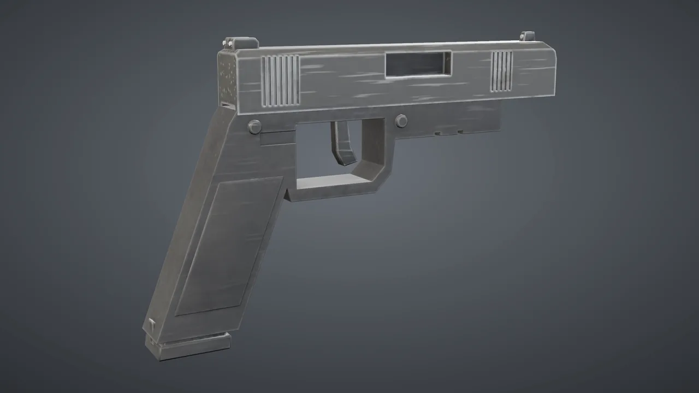

**Pistol** `service_pistol`. A high-detail service pistol with a fifteen-round magazine. Hits harder than zee's dart pistol and reloads quickly.

| Default | |
| --- | --- |
| Damage | 28 (dart) |
| Fire rate | one shot every 0.16 s |
| Fire modes | semi |
| Magazine | 15 + 90 reserve |
| Reload | 1.5 s |
| Spread | 0.6 deg standing, 1.6 moving, 0.5 crouched, 4 airborne |
| Bloom | +0.5 deg per shot, up to 3 |
| Recoil | 0.8 deg up, 0.15 deg side |
| Range | 120 m (falloff 30-70 m to 60 %) |
| Draw time | 0.25 s |
| Weight | 1 kg |

*Rates are the time between shots and ignore reloading; rpm is the cyclic rate of an automatic weapon.*

### Silenced Pistol


**Pistol** `silenced_pistol`. A suppressed pistol with a small sight. A little less damage and a smaller magazine than the service pistol.

| Default | |
| --- | --- |
| Damage | 24 (dart) |
| Fire rate | one shot every 0.16 s |
| Fire modes | semi |
| Magazine | 12 + 90 reserve |
| Reload | 1.5 s |
| Spread | 0.6 deg standing, 1.6 moving, 0.5 crouched, 4 airborne |
| Bloom | +0.5 deg per shot, up to 3 |
| Recoil | 0.8 deg up, 0.15 deg side |
| Range | 120 m (falloff 30-70 m to 60 %) |
| Draw time | 0.25 s |
| Weight | 1 kg |

*Rates are the time between shots and ignore reloading; rpm is the cyclic rate of an automatic weapon.*

### Uzi

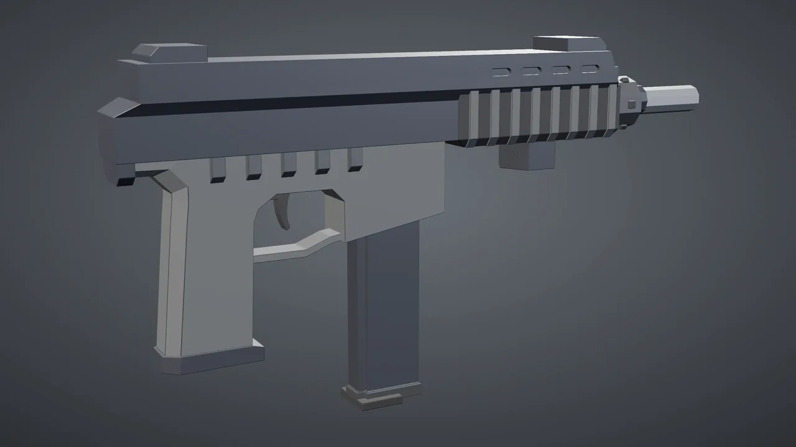

**SMG** `uzi`. A sidearm-slot bullet hose. Very fast and loose, best held close to the horde.

| Default | |
| --- | --- |
| Damage | 14 (dart) |
| Fire rate | 960 rpm |
| Fire modes | auto, semi |
| Magazine | 32 + 128 reserve |
| Reload | 1.8 s |
| Spread | 2 deg standing, 2.8 moving, 0.5 crouched, 4 airborne |
| Bloom | +0.2 deg per shot, up to 3.5 |
| Recoil | 0.35 deg up, 0.25 deg side |
| Range | 80 m (falloff 30-70 m to 60 %) |
| Draw time | 0.25 s |
| Weight | 1 kg |

*Rates are the time between shots and ignore reloading; rpm is the cyclic rate of an automatic weapon.*

### Assault Carbine

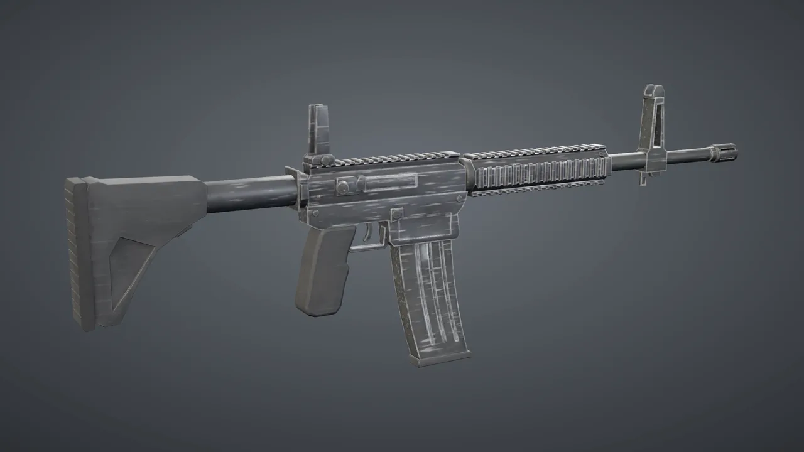

**Assault rifle** `assault_carbine`. The high-detail carbine, about 13k triangles, with sockets for a red dot, 4x scope, suppressor, foregrip, laser and extended magazine. Accurate with a three-round burst.

| Default | |
| --- | --- |
| Damage | 26 (dart) |
| Fire rate | 768 rpm |
| Fire modes | auto, semi, burst |
| Burst | 3 rounds |
| Magazine | 30 + 120 reserve |
| Reload | 2.41 s |
| Spread | 0.7 deg standing, 2 moving, 0.5 crouched, 4 airborne |
| Bloom | +0.14 deg per shot, up to 2.8 |
| Recoil | 0.45 deg up, 0.2 deg side |
| Range | 180 m (falloff 30-70 m to 60 %) |
| Draw time | 0.41 s |
| Weight | 4 kg |

*Rates are the time between shots and ignore reloading; rpm is the cyclic rate of an automatic weapon.*

### AK Rifle

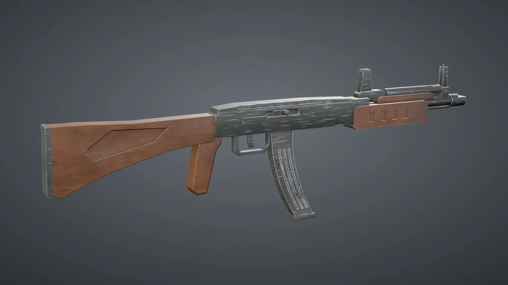

**Assault rifle** `ak_rifle`. Heavier rounds than the carbine with more kick. Hard-hitting in full auto if you can hold it on target.

| Default | |
| --- | --- |
| Damage | 32 (dart) |
| Fire rate | 640 rpm |
| Fire modes | auto, semi |
| Magazine | 30 + 120 reserve |
| Reload | 2.59 s |
| Spread | 0.9 deg standing, 2.4 moving, 0.5 crouched, 4 airborne |
| Bloom | +0.2 deg per shot, up to 3.4 |
| Recoil | 0.62 deg up, 0.3 deg side |
| Range | 170 m (falloff 30-70 m to 60 %) |
| Draw time | 0.45 s |

*Rates are the time between shots and ignore reloading; rpm is the cyclic rate of an automatic weapon.*

### Tactical SMG

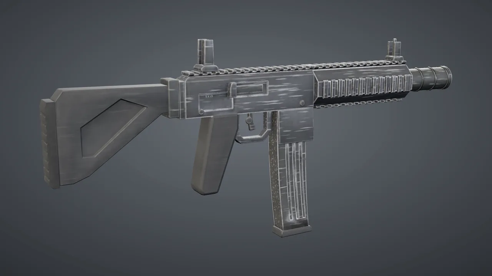

**SMG** `tactical_smg`. A fifty-round SMG for clearing crowds. Fast, light and long-lasting between reloads.

| Default | |
| --- | --- |
| Damage | 19 (dart) |
| Fire rate | 768 rpm |
| Fire modes | auto, semi, burst |
| Burst | 3 rounds |
| Magazine | 50 + 200 reserve |
| Reload | 2.2 s |
| Spread | 1.2 deg standing, 2.2 moving, 0.5 crouched, 4 airborne |
| Bloom | +0.12 deg per shot, up to 2.5 |
| Recoil | 0.3 deg up, 0.18 deg side |
| Range | 110 m (falloff 30-70 m to 60 %) |
| Draw time | 0.31 s |
| Weight | 2.8 kg |

*Rates are the time between shots and ignore reloading; rpm is the cyclic rate of an automatic weapon.*

### Pump Shotgun

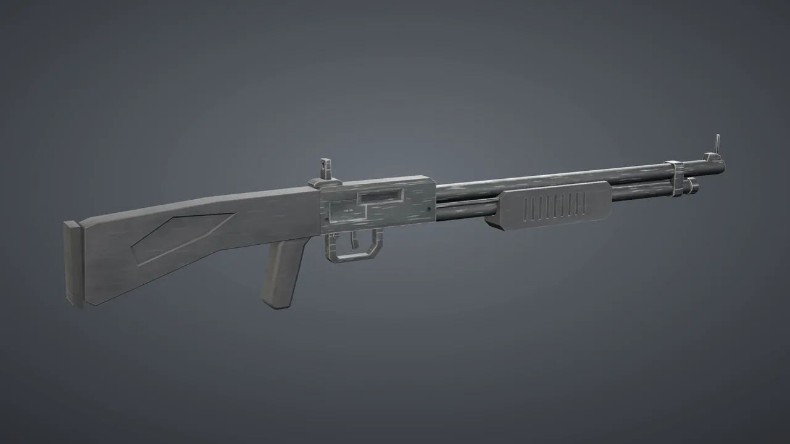

**Shotgun** `pump_shotgun`. Ten pellets a shot and eight shells in the tube. The dependable crowd-stopper at close range.

| Default | |
| --- | --- |
| Damage | 14 x 10 pellets (dart) |
| Fire rate | one shot every 0.86 s |
| Fire modes | semi |
| Magazine | 8 + 56 reserve |
| Reload | 3.41 s |
| Spread | 4.6 deg standing, 0.6 moving, 0.5 crouched, 4 airborne |
| Recoil | 2.6 deg up, 0.15 deg side |
| Range | 24 m |
| Draw time | 0.41 s |

*Rates are the time between shots and ignore reloading; rpm is the cyclic rate of an automatic weapon.*

### Sawed-Off


**Shotgun** `sawed_off`. Two barrels and fourteen pellets each. Devastating at arm's length, useless past fifteen metres.

| Default | |
| --- | --- |
| Damage | 12 x 14 pellets (dart) |
| Fire rate | one shot every 0.25 s |
| Fire modes | semi |
| Magazine | 2 + 40 reserve |
| Reload | 2 s |
| Spread | 7.5 deg standing, 1 moving, 0.5 crouched, 4 airborne |
| Recoil | 3.6 deg up, 0.15 deg side |
| Range | 15 m |
| Draw time | 0.3 s |
| Weight | 4 kg |

*Rates are the time between shots and ignore reloading; rpm is the cyclic rate of an automatic weapon.*

### Hunting Rifle

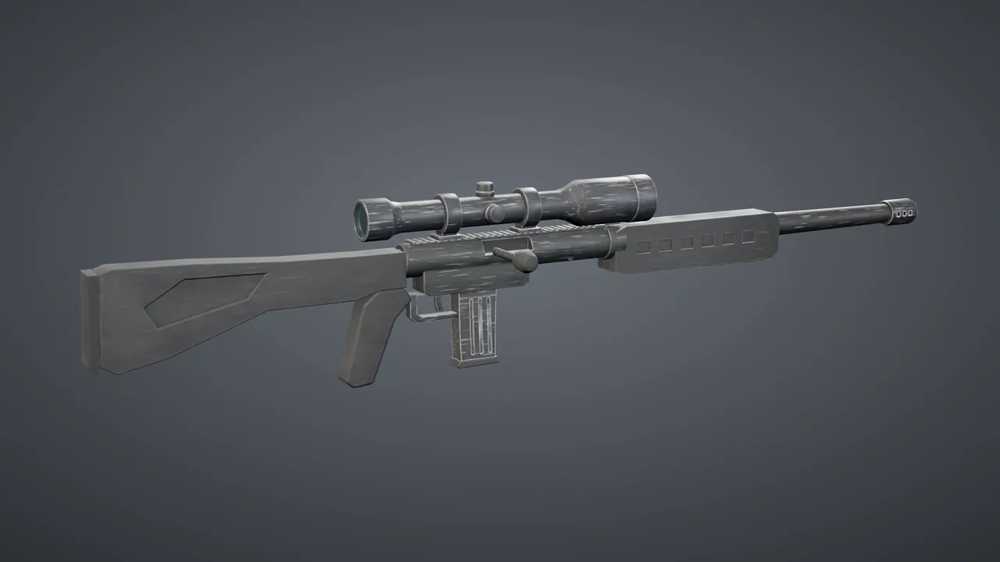

**Rifle** `hunting_rifle`. A scoped bolt-action that drops almost anything in one shot. Pinpoint standing still, wild on the move.

| Default | |
| --- | --- |
| Damage | 90 (dart) |
| Fire rate | one shot every 1 s |
| Fire modes | semi |
| Magazine | 5 + 40 reserve |
| Reload | 2.8 s |
| Spread | 0 deg standing, 6 moving, 12 airborne |
| Recoil | 3.2 deg up, 0.15 deg side |
| Range | 600 m (falloff 30-70 m to 60 %) |
| Draw time | 0.5 s |
| Weight | 5 kg |

*Rates are the time between shots and ignore reloading; rpm is the cyclic rate of an automatic weapon.*

### Machine Gun


**Heavy** `machine_gun`. A belt-fed machine gun with a hundred-round box. Slow to bring up and slow to reload, it holds a doorway on its own.

| Default | |
| --- | --- |
| Damage | 22 (dart) |
| Fire rate | 768 rpm |
| Fire modes | auto |
| Magazine | 100 + 200 reserve |
| Reload | 5 s |
| Spread | 1.8 deg standing, 4 moving, 0.5 crouched, 6 airborne |
| Bloom | +0.06 deg per shot, up to 2.2 |
| Recoil | 0.4 deg up, 0.2 deg side |
| Range | 160 m (falloff 30-70 m to 60 %) |
| Draw time | 0.91 s |
| Weight | 6 kg |

*Rates are the time between shots and ignore reloading; rpm is the cyclic rate of an automatic weapon.*

### Grenade Launcher

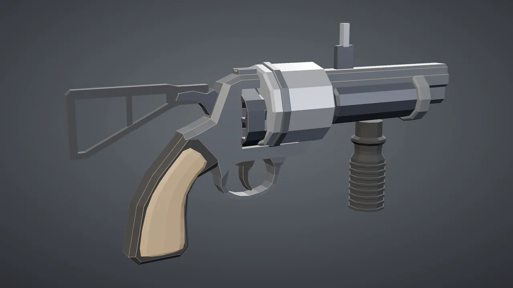

**Launcher** `grenade_launcher`. A single-shot launcher with a big splash. Lob it into a group and reload.

| Default | |
| --- | --- |
| Damage | 30 (blast) |
| Splash | 130 within 5 m |
| Fire rate | one shot every 1 s |
| Fire modes | semi |
| Magazine | 1 + 15 reserve |
| Reload | 2.41 s |
| Recoil | 2.8 deg up, 0.15 deg side |
| Projectile speed | 32 m/s |
| Draw time | 0.5 s |
| Weight | 6 kg |

*Rates are the time between shots and ignore reloading; rpm is the cyclic rate of an automatic weapon.*

### Rocket Launcher

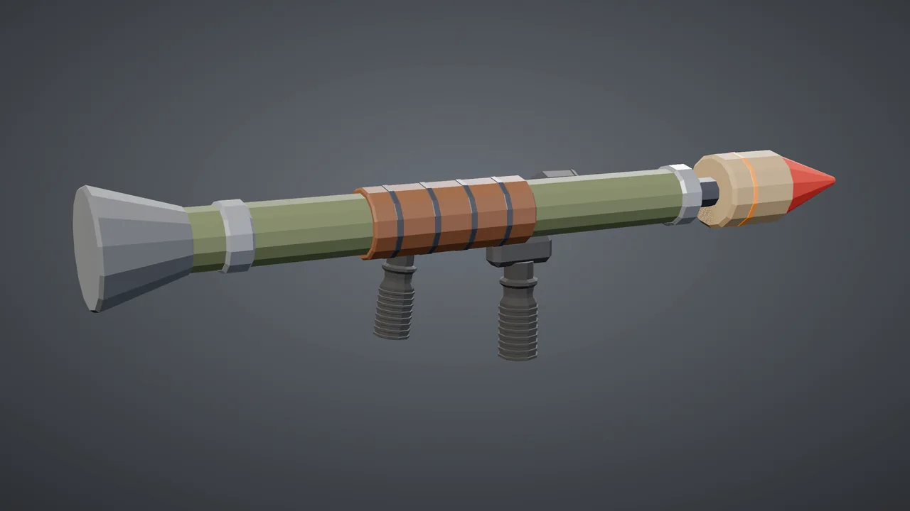

**Launcher** `rocket_launcher`. One rocket, the biggest blast in the pack and a long reload. Save it for the big ones.

| Default | |
| --- | --- |
| Damage | 60 (blast) |
| Splash | 240 within 6.5 m |
| Fire rate | one shot every 1.5 s |
| Fire modes | semi |
| Magazine | 1 + 6 reserve |
| Reload | 3.5 s |
| Recoil | 4 deg up, 0.15 deg side |
| Projectile speed | 36 m/s |
| Draw time | 0.8 s |
| Weight | 6 kg |

*Rates are the time between shots and ignore reloading; rpm is the cyclic rate of an automatic weapon.*

### Flamethrower

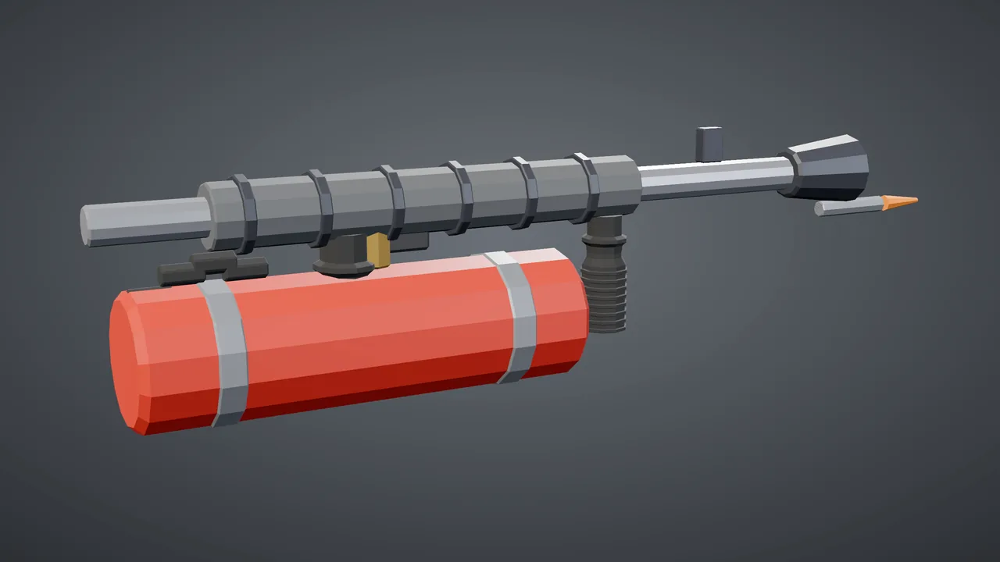

**Heavy** `flamethrower`. A short cone of fire from its own fuel tank, with no reload. Tagged incendiary, so a game can set what it hits alight.

| Default | |
| --- | --- |
| Damage | 5 x 4 pellets (dart) |
| Fire rate | 640 rpm |
| Fire modes | auto |
| Spread | 7 deg standing, 1 moving, 0.5 crouched, 4 airborne |
| Recoil | 0.05 deg up, 0.15 deg side |
| Range | 9 m |
| Draw time | 0.8 s |
| Weight | 6 kg |

*Rates are the time between shots and ignore reloading; rpm is the cyclic rate of an automatic weapon.*

### Molotov

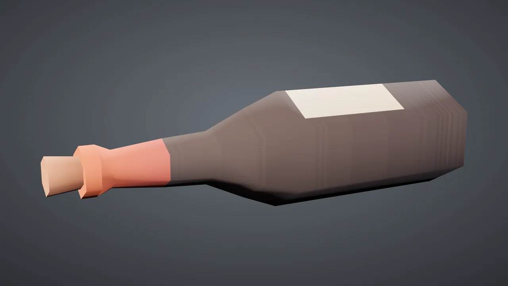

**Thrown** `molotov`. A bottle that breaks where it lands. In game-zombie-zone it starts a fire; elsewhere the game decides.

| Default | |
| --- | --- |
| Fire rate | one throw every 1 s |
| Fire modes | charge |
| Carried | 1 (max 1) |
| Recoil | 0.4 deg up, 0.15 deg side |
| Projectile speed | 18 m/s |
| Fuse | 10 s |
| Draw time | 0.34 s |
| Weight | 0.4 kg |

*Rates are the time between shots and ignore reloading; rpm is the cyclic rate of an automatic weapon.*

### Pipe Bomb

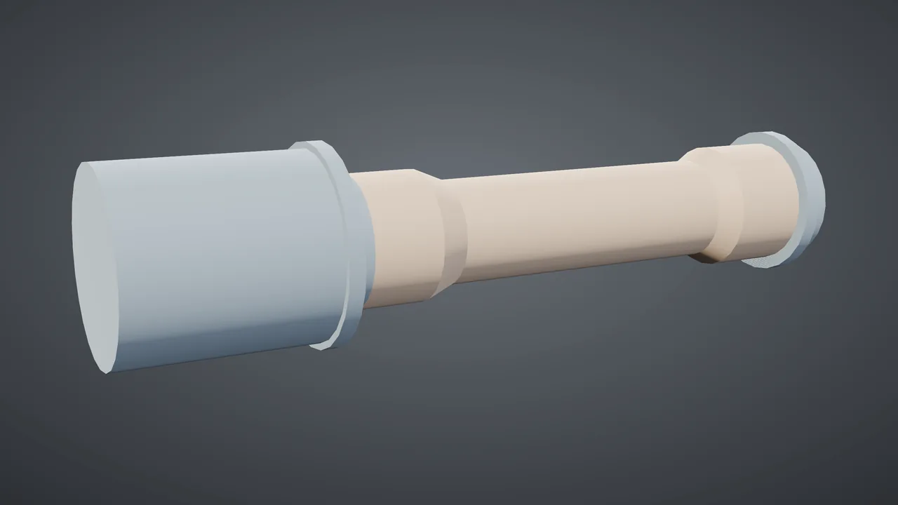

**Thrown** `pipe_bomb`. The biggest splash of any weapon in the pack. In game-zombie-zone it beeps, draws the horde and goes off.

| Default | |
| --- | --- |
| Splash | 300 within 6 m |
| Fire rate | one throw every 1 s |
| Fire modes | charge |
| Carried | 1 (max 1) |
| Recoil | 0.4 deg up, 0.15 deg side |
| Projectile speed | 18 m/s |
| Fuse | 10 s |
| Draw time | 0.34 s |
| Weight | 0.4 kg |

*Rates are the time between shots and ignore reloading; rpm is the cyclic rate of an automatic weapon.*

### Bile Jar

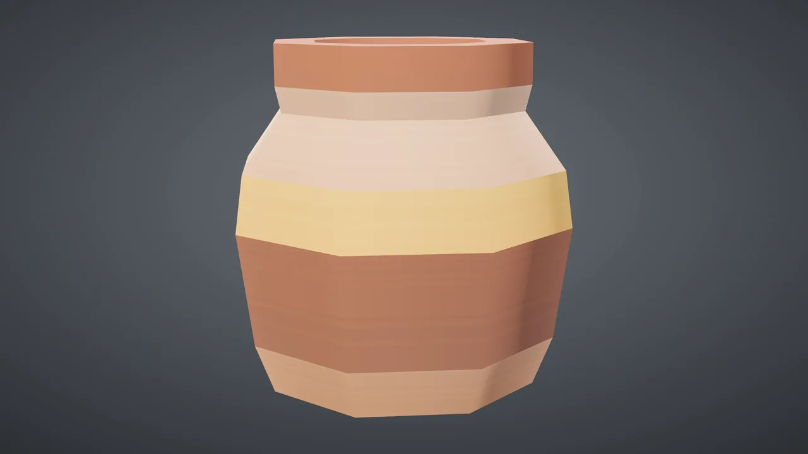

**Thrown** `bile_jar`. A jar that breaks where it lands. In game-zombie-zone it pulls nearby zombies to the spot.

| Default | |
| --- | --- |
| Fire rate | one throw every 1 s |
| Fire modes | charge |
| Carried | 1 (max 1) |
| Recoil | 0.4 deg up, 0.15 deg side |
| Projectile speed | 18 m/s |
| Fuse | 10 s |
| Draw time | 0.34 s |
| Weight | 0.4 kg |

*Rates are the time between shots and ignore reloading; rpm is the cyclic rate of an automatic weapon.*
<!-- /gen_readme:weapons -->

<!-- gen_readme:quality -->
## Quality and ongoing improvement

The models, textures, sounds and animations in this pack are being improved over time, and some of them are low quality today. Improvement is driven by the Nightly queue, a work queue where agents pick up items, and by a visual judge loop that views rendered frames and files defects until each asset passes repeated clean reviews. Known defects are filed there and fixed in later releases, and the screenshots in this README are regenerated as the assets improve.
<!-- /gen_readme:quality -->

## Credits

The eleven real-world guns (`assets/kitbash/`) are rebuilt by `blender -b --python art-src/guns/build.py` (one recipe per gun in `zed_guns.py`). Parts are cut, reshaped and joined with modelled barrels, sights, rails and magazines, so no gun is any one source model. Each kit's licence is next to its files.

| Asset | Author / source | Licence |
| --- | --- | --- |
| Eleven real-world guns (parts) | [Quaternius](https://quaternius.com), [Ultimate Low Poly Guns Pack](https://opengameart.org/content/low-poly-guns-pack) | CC0 1.0 |
| Eleven real-world guns (parts) | [Kenney](https://kenney.nl/assets/blaster-kit), Blaster Kit | CC0 1.0 |
| Pipe bomb, magazines and rounds | [Kenney](https://kenney.nl), Weapon Pack | CC0 1.0 |
| Molotov (wine bottle), bile jar (honey jar) | [Kenney](https://kenney.nl), Food Kit | CC0 1.0 |
| High-detail carbine and attachments (`assets/hq/`) | TMC: modelled and textured procedurally by `art-src/hq/` | CC0 1.0 |
| Code | TMC | MIT, see [LICENSE](LICENSE) |
